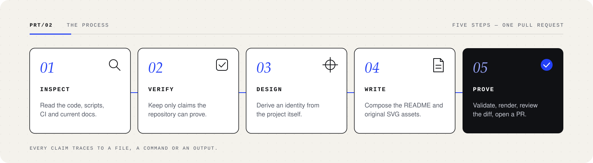

<a id="top"></a>

<p align="center">
  <picture>
    <source media="(prefers-reduced-motion: reduce)" srcset="docs/assets/readme/hero-still.svg" />
    
  </picture>
</p>

<h1 align="center">Premium README Template</h1>

<p align="center">
  <strong>Beautiful documentation. Real engineering.</strong><br />
  Guidelines, prompts, templates and a validator that let a coding agent turn any repository's README into a product-grade page where every claim is true.
</p>

<p align="center">
  <a href="https://github.com/jeancarlosaps/premium-readme-template/actions/workflows/validate.yml"></a>
  <a href="LICENSE"></a>
</p>

<p align="center">
  <a href="#quick-start"><strong>QUICK START →</strong></a>
  &nbsp;·&nbsp;
  <a href="#how-it-works">HOW IT WORKS</a>
  &nbsp;·&nbsp;
  <a href="#whats-inside">WHAT'S INSIDE</a>
  &nbsp;·&nbsp;
  <a href="examples/sample-project/README.md">EXAMPLE</a>
  &nbsp;·&nbsp;
  <a href="CONTRIBUTING.md">CONTRIBUTE</a>
</p>

---

## 01 · Why

A README is the front door of a project. Most are either plain and accurate, or beautiful and partly invented. Coding agents make both easier: they can write a page in minutes, and they can just as quickly describe features that do not exist.

This template sets one standard for both halves:

| Principle | In practice |
|---|---|
| **Visual excellence** | An original hero with a static twin, a small family of figures, editorial hierarchy |
| **Engineering accuracy** | Every feature, version, command and status traces to a file or an output |
| **Project identity** | Colours and motifs come from the project, never from this repository |
| **Accessibility** | Alt text that says something, reduced-motion support, contrast, mobile widths, information in text |
| **Maintainability** | Few assets, generated stills, status tables that are easy to update in the same PR |

The appearance never overrides accuracy. A README built with this template says "not implemented yet" when that is the truth.

<a id="quick-start"></a>

## 02 · Quick start

Open your agent at the root of the project you want to document, then use one of the three ways below. The agent inspects the repository, shows you a plan, creates the assets and the README on a branch, validates them and opens a pull request. It does not merge.

### Any agent

Paste this. It works with any agent that can read URLs, edit files and run commands:

```text
Read https://raw.githubusercontent.com/jeancarlosaps/premium-readme-template/main/prompts/apply-to-project.md and apply it to this project.
```

### Claude Code

The prompt above works as is. To make it a one-liner in every project, install the skill once:

```bash
mkdir -p ~/.claude/skills/premium-readme
curl -fsSL https://raw.githubusercontent.com/jeancarlosaps/premium-readme-template/main/.claude/skills/premium-readme/SKILL.md -o ~/.claude/skills/premium-readme/SKILL.md
```

Then, in any repository:

```text
Use the Premium README Template on this project.
```

[`CLAUDE.md`](CLAUDE.md) explains why this repository's own instructions do not load in other projects, and lists a third option with a local clone.

### Cursor

Install the rule in the project:

```bash
mkdir -p .cursor/rules
curl -fsSL https://raw.githubusercontent.com/jeancarlosaps/premium-readme-template/main/.cursor/rules/premium-readme.mdc -o .cursor/rules/premium-readme.mdc
```

The rule is "Apply Intelligently": it loads only when the request is about a README. Ask in Agent mode:

```text
Use the Premium README Template on this project.
```

If your project should not version agent configuration, add `.cursor/rules/premium-readme.mdc` to `.git/info/exclude` and keep it local.

### Other tasks

| Goal | Prompt |
|---|---|
| Audit an existing README without redesigning it | `Read https://raw.githubusercontent.com/jeancarlosaps/premium-readme-template/main/prompts/audit-existing-readme.md and audit this project's README.` |
| Create or refresh only the illustrations | `Read https://raw.githubusercontent.com/jeancarlosaps/premium-readme-template/main/prompts/create-visual-assets.md and create the README illustrations for this project.` |

<a id="how-it-works"></a>

## 03 · How it works

<p align="center">
  
</p>

1. **Inspect.** Manifests, lockfiles, structure, tests, CI, the current README, any existing visual identity.
2. **Verify.** An evidence table: each claim, where it comes from, whether it was run. Safe commands are executed.
3. **Design.** Sections chosen from the [catalogue](templates/README.template.md), a palette and a concept derived from the project. You approve the plan before anything is written.
4. **Write.** Hero and still, at most a few figures, the README, a `DESIGN.md` that keeps future figures consistent.
5. **Prove.** Validator, Markdown lint, a security sweep, a look at the rendered page on GitHub (light, dark, mobile, reduced motion), then a pull request with the evidence.

The full procedure is [`prompts/apply-to-project.md`](prompts/apply-to-project.md).

## 04 · What a project receives

| Output | Notes |
|---|---|
| `README.md` | Only the sections the project can fill honestly |
| `docs/assets/readme/hero.svg` + `hero-still.svg` | Original, animated once in under four seconds; the still is generated from it |
| Architecture, flow or roadmap figures | Only when they help, and only from real sources |
| `docs/assets/readme/DESIGN.md` | Palette, type, shape and motion rules for that project |
| A pull request | Evidence table, commands run, validator output, what was not verified |

<a id="whats-inside"></a>

## 05 · What's inside

```text
premium-readme-template/
├── AGENTS.md                      # entry point for every agent
├── CLAUDE.md                      # imports AGENTS.md; Claude Code notes
├── .claude/skills/premium-readme/ # optional Claude Code skill
├── .cursor/rules/                 # optional Cursor rule
├── prompts/                       # apply · audit · visual assets
├── guidelines/                    # the rules, one topic per file
├── templates/                     # README, DESIGN and CONTRIBUTING skeletons
├── examples/sample-project/       # one fictional, fully worked example
├── scripts/validate-readme.mjs    # dependency-free validator
└── docs/assets/readme/            # this README's own illustrations
```

| Guideline | Covers |
|---|---|
| [Technical accuracy](guidelines/technical-accuracy.md) | Evidence for each kind of claim, wording for planned or unverified things, commands, badges |
| [Visual design](guidelines/visual-design.md) | Deriving an identity, colour tokens, typography for GitHub, grid, illustrations, SVG vs. Mermaid, Markdown elements |
| [Accessibility](guidelines/accessibility.md) | Alt text, structure, contrast, motion and the static twin, small screens |
| [GitHub compatibility](guidelines/github-compatibility.md) | What GitHub keeps, strips and renders, observed with the official renderer |
| [Validation](guidelines/validation.md) | The validator, what it cannot check, the manual pass, the security sweep |

## 06 · Example

[**waypost**](examples/sample-project/README.md) is a fictional Go webhook delivery service, written to show the standard end to end: its own night-and-signal identity, an animated hero with a still, an SVG architecture figure, a Mermaid sequence diagram, and demonstration commands that are labelled as such.

<p align="center">
  <a href="examples/sample-project/README.md"></a>
</p>

It is one example on purpose: a different project should look different, not like a variation of this one.

## 07 · Validator

[`scripts/validate-readme.mjs`](scripts/validate-readme.mjs) is a single file for Node.js 18+, with no dependencies. It checks local links and anchors, alt text, leftover placeholders, Mermaid headers, SVG structure and safety, and that every animated SVG has a reduced-motion rule and an up-to-date static twin.

```bash
node scripts/validate-readme.mjs --write-stills   # regenerate *-still.svg from animated SVGs
node scripts/validate-readme.mjs                  # check; exits 1 on errors
```

In any other project, without adding it to that project:

```bash
curl -fsSL https://raw.githubusercontent.com/jeancarlosaps/premium-readme-template/main/scripts/validate-readme.mjs -o /tmp/validate-readme.mjs
node /tmp/validate-readme.mjs .
```

What it checks and, as important, what it cannot check: [guidelines/validation.md](guidelines/validation.md).

## 08 · Limitations

- **Agents differ.** The prompts are plain Markdown and tool-neutral, but an agent without file, shell or web access cannot complete every step. The procedure asks it to report what it skipped.
- **Fonts are the visitor's.** GitHub shows SVGs as images, which cannot load web fonts. The guidelines design for fallbacks; exact rendering still varies by system.
- **Mermaid is not validated by the script** beyond its first line. GitHub renders it client-side; check the page.
- **The prompt URLs track `main`.** Point to a tag or commit instead of `main` in the URL if you need a frozen version.
- **Other renderers** (package registries, IDE previews) may ignore `<picture>`, `align` and Mermaid. The README stays readable because the information is in text.

## 09 · Contributing

Improvements to guidelines, prompts, the validator or the example are welcome. Read [CONTRIBUTING.md](CONTRIBUTING.md); in short: one topic per pull request, run the validator, render any SVG you touch, keep the example fictional and labelled.

## 10 · License

[MIT](LICENSE). The illustrations in this repository are original and covered by the same licence.

<p align="right"><a href="#top">Back to top ↑</a></p>
