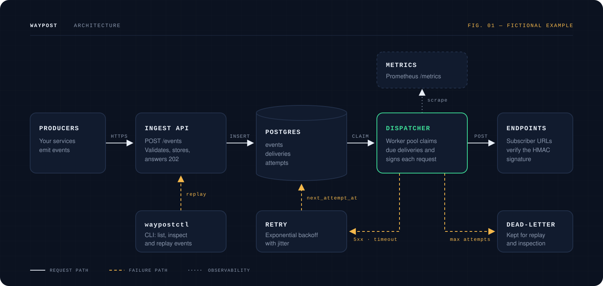
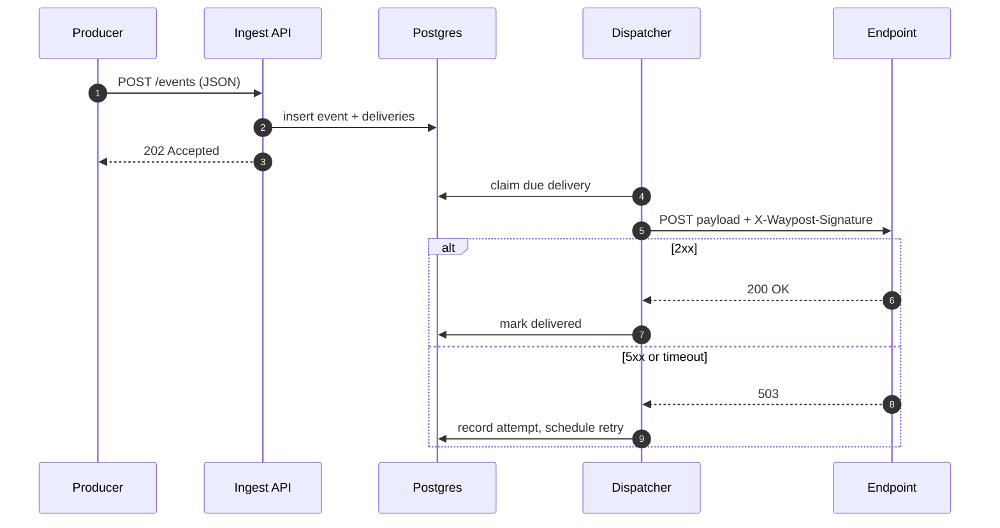

<a id="top"></a>

<p align="center">
  <picture>
    <source media="(prefers-reduced-motion: reduce)" srcset="assets/hero-still.svg" />
    
  </picture>
</p>

<h1 align="center">waypost</h1>

<p align="center">
  <strong>Webhooks that arrive.</strong><br />
  A self-hosted webhook delivery service in Go: signed requests, retries with backoff, a dead-letter table and replay.
</p>

<p align="center">
  
</p>

> [!IMPORTANT]
> **waypost is fictional.** This README demonstrates the [Premium README standard](../../README.md) on an invented project. There is no waypost code, release, CI or test suite; every command, path and number below is illustrative. A real README built with the template contains only claims the repository can prove.

<p align="center">
  <a href="#quick-start"><strong>QUICK START →</strong></a>
  &nbsp;·&nbsp;
  <a href="#architecture">ARCHITECTURE</a>
  &nbsp;·&nbsp;
  <a href="#delivery-guarantees">GUARANTEES</a>
  &nbsp;·&nbsp;
  <a href="#configuration">CONFIGURATION</a>
  &nbsp;·&nbsp;
  <a href="#how-this-example-was-built">HOW THIS WAS BUILT</a>
</p>

---

## Overview

Services that emit webhooks end up re-implementing the same fragile loop: sign the payload, post it, retry on failure, give up eventually, and explain to a customer what happened. waypost takes that loop out of your application. Your services post an event once; waypost delivers it to every subscriber, at least once, and keeps a record of every attempt.

**It is:** a single binary plus Postgres, an HTTP ingest API, a dispatcher, and a CLI for inspection and replay.
**It is not:** a message broker, an event store for your domain, or a hosted service.

## Features

| Feature | Status | Where |
|---|---|---|
| Ingest API, `POST /events`, answers `202` once stored | Done | `internal/ingest/` |
| HMAC-SHA256 signature header on every delivery | Done | `internal/sign/` |
| Exponential backoff with jitter, per-subscription limits | Done | `internal/retry/` |
| Dead-letter table after the maximum attempts | Done | `internal/store/deadletter.go` |
| `waypostctl replay` for dead-lettered events | Done | `cmd/waypostctl/` |
| Prometheus metrics | Done | `internal/metrics/` |
| Per-endpoint rate limiting | Planned | — |

<sub>Illustrative status. In a real project each "Done" row points to code that was read, and each "Planned" row to an issue.</sub>

<a id="architecture"></a>

## Architecture

<p align="center">
  
</p>

| Component | Responsibility | Never does |
|---|---|---|
| **Ingest API** | Validates the event, stores it with one delivery per subscription, answers `202` | Call subscribers |
| **Postgres** | Source of truth for events, deliveries and attempts | — |
| **Dispatcher** | Claims due deliveries with `SELECT … FOR UPDATE SKIP LOCKED`, signs and posts them | Decide retry timing |
| **Retry scheduler** | Computes the next attempt time; moves deliveries to dead-letter after the limit | Send HTTP requests |
| **waypostctl** | Lists, inspects and replays events through the ingest API | Write to Postgres directly |

One delivery, step by step:



## Stack

| Layer | Choice | Version |
|---|---|---|
| Language | Go | 1.25 |
| Storage | PostgreSQL | 16 |
| HTTP | `net/http` standard library | — |
| Metrics | Prometheus client | — |

<sub>Illustrative versions. A real README takes them from `go.mod` and the deployment manifests.</sub>

## Project structure

```text
waypost/
├── cmd/
│   ├── waypost/          # server binary: ingest + dispatcher
│   └── waypostctl/       # inspection and replay CLI
├── internal/
│   ├── ingest/           # POST /events
│   ├── dispatch/         # worker pool, HTTP delivery
│   ├── retry/            # backoff policy
│   ├── sign/             # HMAC-SHA256 signatures
│   ├── store/            # Postgres queries and migrations
│   └── metrics/          # Prometheus collectors
└── deploy/
    └── compose.yaml      # local Postgres + waypost
```

<a id="quick-start"></a>

## Quick start

> [!NOTE]
> Demonstration commands. They show the format a real README uses; they do not run anything, because waypost does not exist.

### Requirements

- Go 1.25 or newer
- Docker, for the local Postgres

### Run locally

```bash
git clone https://github.com/example/waypost.git
cd waypost
docker compose -f deploy/compose.yaml up -d postgres
go run ./cmd/waypost
```

### Send an event

```bash
curl -X POST http://localhost:8080/events \
  -H 'Content-Type: application/json' \
  -d '{"type": "invoice.paid", "data": {"id": "inv_123"}}'
```

<a id="configuration"></a>

## Configuration

| Variable | Required | Default | Purpose |
|---|---|---|---|
| `WAYPOST_DATABASE_URL` | Yes | — | Postgres connection string |
| `WAYPOST_SIGNING_SECRET` | Yes | — | Key for the HMAC-SHA256 signature |
| `WAYPOST_MAX_ATTEMPTS` | No | `8` | Attempts before dead-letter |
| `WAYPOST_WORKERS` | No | `16` | Concurrent deliveries |

Secrets come from the environment. Never commit them.

<a id="delivery-guarantees"></a>

## Delivery guarantees

| Guarantee | Meaning for subscribers |
|---|---|
| At least once | A delivery can repeat. Deduplicate with the `X-Waypost-Event-Id` header |
| No ordering | Events may arrive out of order; use the event timestamp |
| Bounded retries | After `WAYPOST_MAX_ATTEMPTS` failures the delivery is dead-lettered, never silently dropped |

## Tests

```bash
go test ./...
go test -tags integration ./internal/store/...   # needs the local Postgres
```

<sub>Illustrative. A real README states how many tests ran, when, and links the CI run.</sub>

---

<a id="how-this-example-was-built"></a>

## How this example was built

| Template element | Here |
|---|---|
| Identity derived from the domain | Night background, one "signal" green for delivered, amber for retries and failure paths. See the [template's visual guideline](../../guidelines/visual-design.md) |
| Animated hero + generated still | [`assets/hero.svg`](assets/hero.svg), [`assets/hero-still.svg`](assets/hero-still.svg) |
| Static architecture figure | [`assets/architecture.svg`](assets/architecture.svg), with legend and solid/dashed line language |
| Mermaid for what changes often | The sequence diagram above |
| Honest labelling | The fictional notice, "illustrative" footnotes, no CI badge |

<p align="right"><a href="#top">Back to top ↑</a></p>
